# 远程下载

> ⬇️ 随时随地控制家里的下载任务 

> ⏱️ 预计配置时间：10 分钟

> 📱 支持：Aria2、qBittorrent、Transmission、百度云

---

## 支持方案对比

| 下载工具 | 适用场景 | 难度 | 推荐度 |
|---------|---------|------|--------|
| Aria2 | 通用下载、HTTP/BT/磁力 | ⭐⭐⭐ | ⭐⭐⭐ |
| qBittorrent | BT 下载首选 | ⭐⭐ | ⭐⭐⭐ |
| Transmission | 轻量级 BT | ⭐⭐ | ⭐⭐ |
| BaiduPCS | 百度云下载 | ⭐⭐ | ⭐⭐ |

---

## Aria2 远程下载

### 1. 安装 Aria2

#### iStoreOS/OpenWrt

1. iStore商店/软件中心搜索安装 Aria2
2. 启用 Aria2，设置 RPC 认证令牌
3. 设置下载目录

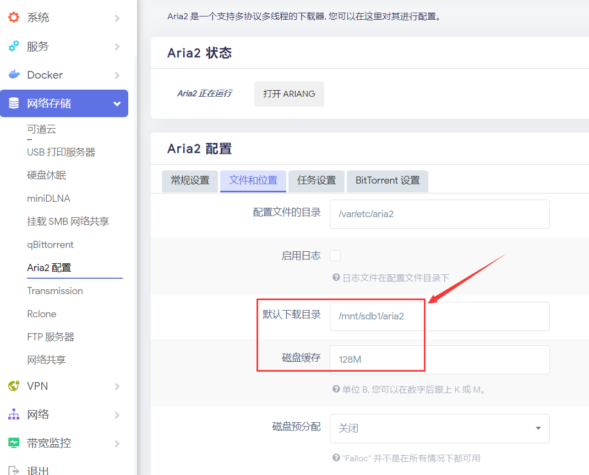

#### Docker 安装（通用）

```bash
docker run -d \
    --name aria2-pro \
    --restart unless-stopped \
    --network host \
    -e PUID=$UID \
    -e PGID=$GID \
    -e RPC_SECRET=你的令牌 \
    -e RPC_PORT=6880 \
    -v $PWD/aria2-config:/config \
    -v $PWD/downloads:/downloads \
    p3terx/aria2-pro
```

**参数说明：**
- `RPC_SECRET`: 设置 RPC 密码，记住后面要用
- `RPC_PORT`: RPC 端口，默认 6880
- `/downloads`: 下载目录映射

---

### 2. 配置 AriaNg（Web 管理界面）

1. 确保 Aria2 已启动
2. 访问 AriaNg 控制台（OpenWrt 通常在服务菜单中）
3. 配置 RPC 连接：
   - **RPC地址**: `路由器IP`
   - **RPC密钥**: 上一步设置的 `RPC_SECRET`

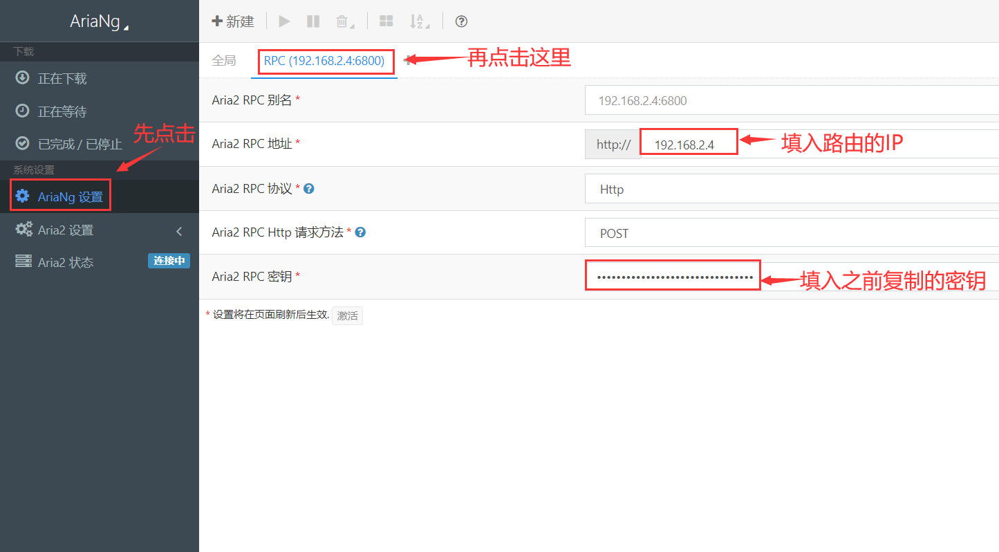

4. 重载后显示已连接

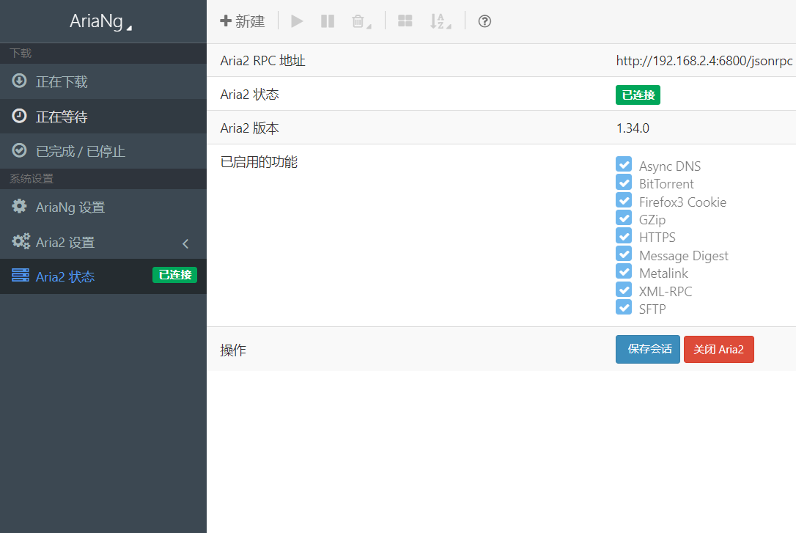

---

### 3. 配置 DDNSTO 远程下载

登录 [DDNSTO 控制台](https://www.ddnsto.com/app/#/login) → 选择设备 → 远程应用 → "添加应用" → 选择 **"Aria2远程"**

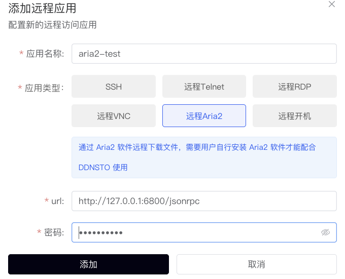

   - **应用名称**: 自定义，如 "家中下载"
   - **RPC 地址**: `http://路由器IP:6880/jsonrpc`
   - **密码**: 前面设置的 `RPC_SECRET`

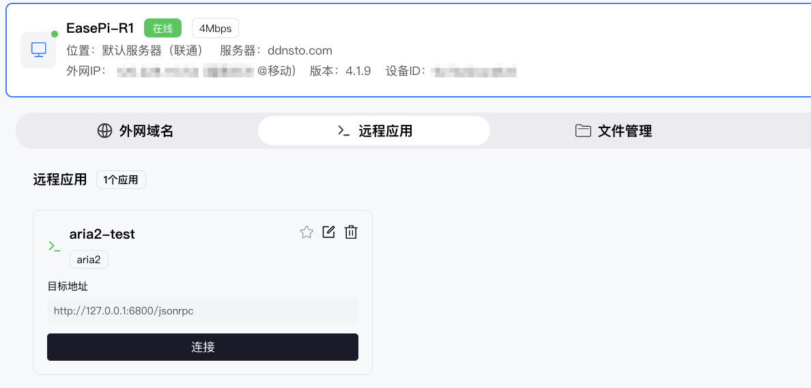

   - **"添加完成"** 后 → 远程应用 → 点击刚添加的 **"Aria2应用"** 连接即可

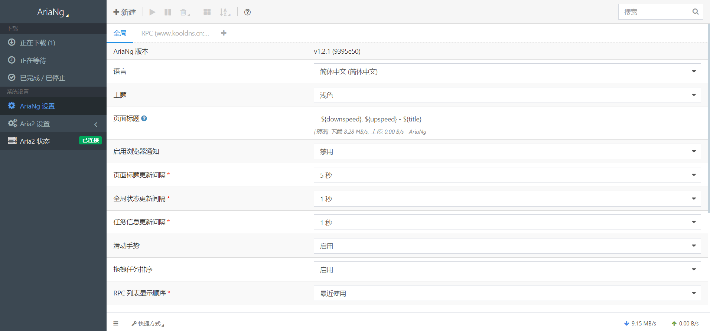

---

### 4. 开始下载

1. 进入远程 Aria2 界面
2. 点击 **"新建"**
3. 粘贴下载链接（HTTP/BT/磁力链接）
4. 点击开始下载

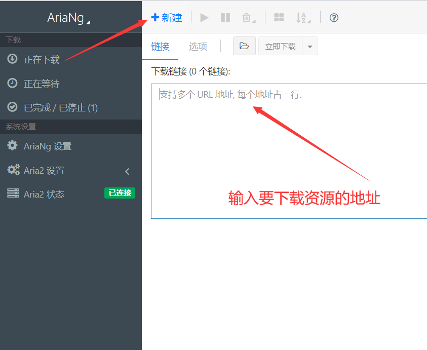

---

## 本地Aria2客户端通过ddnsto远程下载

流程：**准备 Aria2 客户端 → 用 DDNSTO 映射内网 RPC 端口 → 把外网 RPC 地址填入客户端。**

下面以 aria2 运行在 `192.168.50.100:6800` 为例。

**1. 准备客户端**

推荐使用 **AriaNg**，可以从 [官方发布页](https://github.com/mayswind/AriaNg/releases) 下载 `AllInOne` 包，解压后在电脑浏览器中打开 `index.html`。

它只是管理界面，实际下载仍由家里的 aria2 执行，文件也保存在家里的设备上。

**2. 确认 aria2 的 RPC 已开启**

在路由器插件设置或 aria2 配置文件中确认：

```ini
enable-rpc=true
rpc-listen-all=true
rpc-listen-port=6800
rpc-secret=替换成你自己的随机长密钥
rpc-allow-origin-all=true
```

其中 `rpc-allow-origin-all` 用于网页客户端跨域连接。修改配置后重启 aria2，先在局域网确认客户端能够连接 `http://192.168.50.100:6800/jsonrpc`。[aria2 官方配置说明](https://aria2.github.io/manual/en/html/aria2c.html#rpc-options)

**3. 在 DDNSTO 添加外网域名**

进入 DDNSTO 控制台，选择能够访问这台机器的在线设备，添加域名映射：

| 配置项 | 示例 |
|---|---|
| 域名前缀 | `myaria123` |
| 目标主机／内网地址 | `http://192.168.50.100:6800` |

这里映射的是 **6800 RPC 服务**，目标主机不填写 `/ariang/#!/downloading`，也不用附加 `/jsonrpc`。[DDNSTO 目标主机说明](https://doc.linkease.com/zh/guide/ddnsto/troubleshooting/domain-issues.html)

假设控制台分配的域名是：

```text
myaria123.ddnsto.com
```

那么客户端使用的完整 RPC 地址就是：

```text
https://myaria123.ddnsto.com/jsonrpc
```

请换成控制台实际分配的域名。

**4. 完成 DDNSTO 身份验证**

在使用客户端的同一网络下，先用浏览器打开：

```text
https://myaria123.ddnsto.com
```

如果出现 DDNSTO 身份验证页面，按提示完成验证，再返回客户端连接。DDNSTO 会判断访问 IP 是否已验证；切换网络后若连接失败，需要重新访问域名完成验证。[DDNSTO 身份验证说明](https://doc.linkease.com/zh/guide/ddnsto/scenarios/authentication.html)

RPC 服务本身没有普通首页，验证后没有显示管理页面，并不代表映射失败。

**5. 在客户端填写外网 RPC 配置**

打开 AriaNg 的「AriaNg 设置 → RPC」，填写：

| 配置项 | 填写内容 |
|---|---|
| RPC 协议 | `HTTPS` |
| RPC 地址 | `myaria123.ddnsto.com` |
| RPC 端口 | `443` |
| RPC 接口 | `jsonrpc` |
| RPC 密钥 | 第 2 步配置的 `rpc-secret`，只填密钥本身 |

**外网端口填写 `443`，6800 只用于 DDNSTO 的内网目标地址。** AriaNg 的地址、端口、接口是分开填写的；其他客户端如果只有一个地址输入框，直接填写完整的 `https://myaria123.ddnsto.com/jsonrpc`。[AriaNg 配置字段](https://github.com/mayswind/AriaNg/blob/master/src/views/settings-ariang.html)

保存并重载 AriaNg，显示“已连接”后，就可以添加下载、暂停任务和查看进度了。

---

## qBittorrent 远程下载

### 1. 安装 qBittorrent

在 Docker 或 NAS 上安装 qBittorrent，注意记录 WebUI 端口（默认 8080）。

### 2. 配置 qBittorrent

1. 进入 qBittorrent WebUI 设置
2. **关闭 CSRF 保护**（必须！否则 DDNSTO 无法访问）

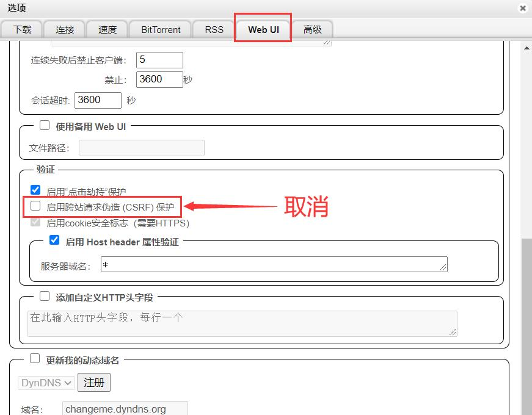

### 3. 配置 DDNSTO 外网域名

1. 添加外网域名：
   - **外网域名**: `myqb112233`
   - **内网地址**: `http://路由器IP:8080`

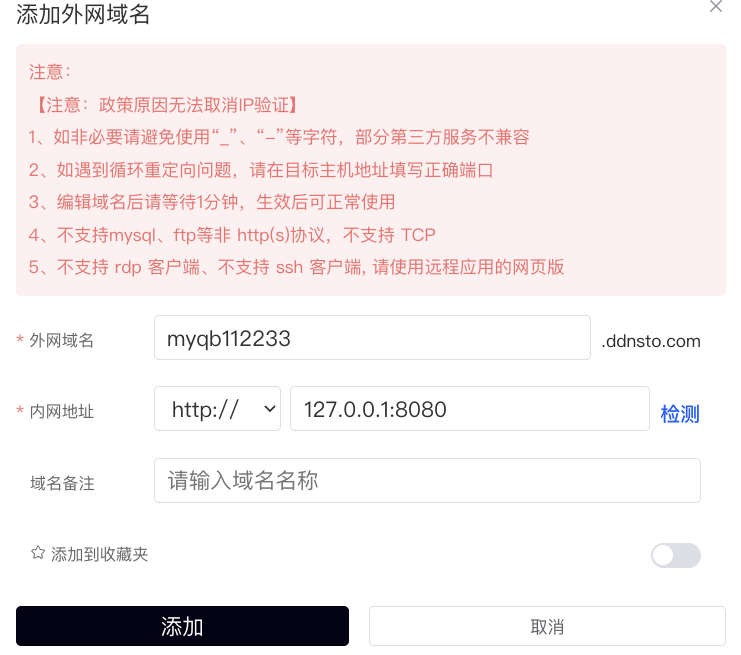

2. 点击刚添加的外网域名 `https://myqb112233.ddnsto.com` 即可远程管理

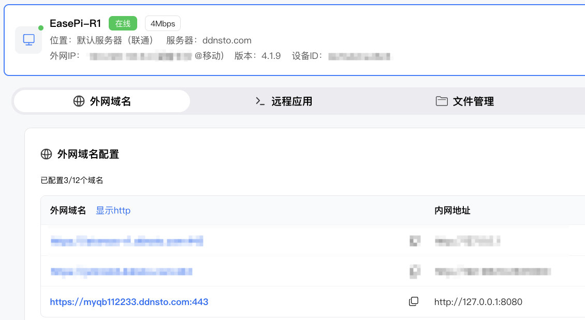

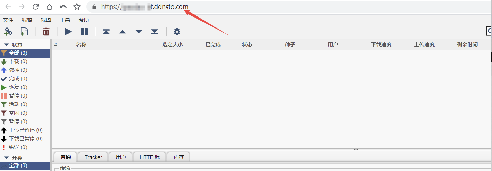

---

## Transmission 远程下载

### 配置步骤

1. 安装 Transmission 并启用 WebUI
2. 记录 RPC 端口（默认 9091）
3. DDNSTO 添加外网域名：
   - **外网域名**: `mytr112233`
   - **内网地址**: `http://路由器IP:9091`

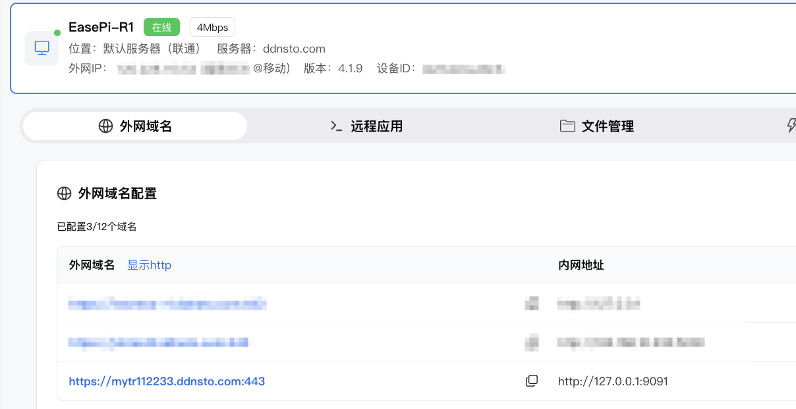

4. 点击刚添加的外网域名 `https://mytr112233.ddnsto.com` 即可远程管理

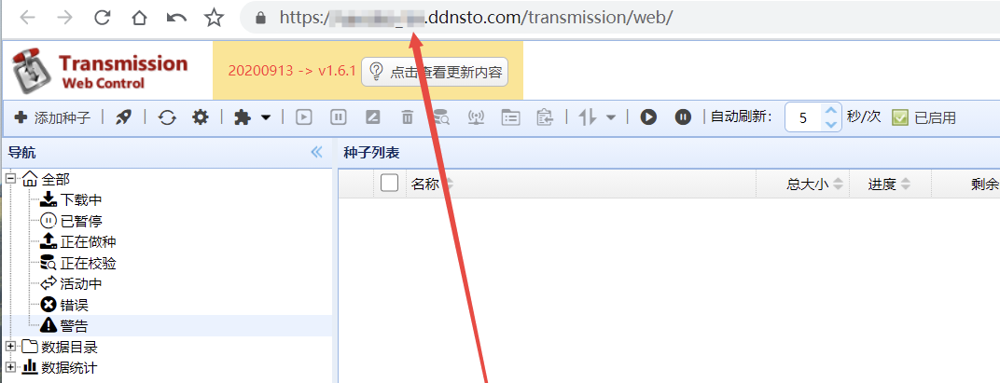

---

## 百度云远程下载

使用 BaiduPCS-Web 实现百度云远程下载：

1. 安装 BaiduPCS-Web

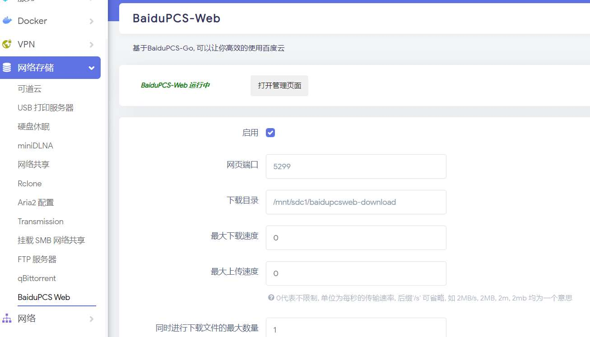

2. 记录网页端口（默认 5299）
3. DDNSTO 添加外网域名：
   - **外网域名**: `mybd112233`
   - **内网地址**: `http://路由器IP:5299`

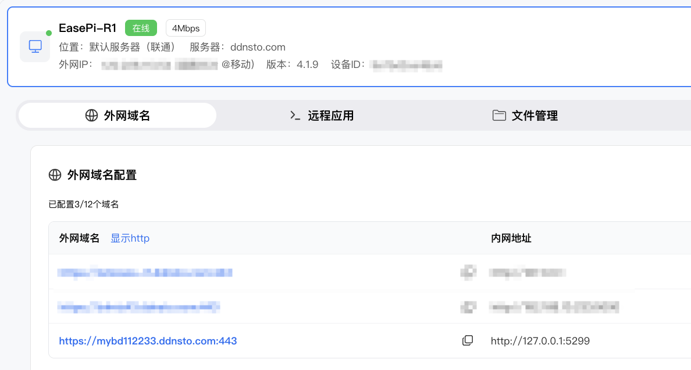

4. 点击刚添加的外网域名 `https://mybd112233.ddnsto.com` 即可远程管理

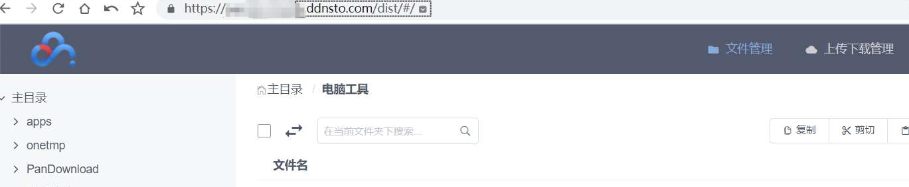

---

## 常见问题

### Q: Aria2 显示未连接？
A: 检查：
- RPC 地址和端口是否正确
- RPC 密钥是否匹配
- Aria2 服务是否正常运行

### Q: qBittorrent 显示 Forbidden？
A: 必须在 qBittorrent 设置中**关闭 CSRF 保护**。

### Q: 下载速度慢？
A: 检查：
- 种子/链接的健康度
- NAS 所在网络的上行带宽
- DDNSTO 套餐带宽限制

### Q: 下载完成如何取回文件？
A: 建议配合 [文件管理](./file-management.md) 使用，或配合易有云同步。

---

## 下一步

- 📁 [配置文件管理](./file-management.md) —— 远程管理下载的文件
- ⚡ [设置远程开机](./remote-wol.md) —— 下载前远程唤醒 NAS
- 🖥️ [远程桌面](./remote-desktop.md) —— 远程管理下载软件
