# TCP 端口转发

> ⚙️ 关联远程桌面、SSH，或自由配置单端口 TCP 服务。

---

## 使用须知

- 请合法合规使用 TCP 端口转发功能，不得用于违法活动。若有充分证据表明该功能被用于违法活动，平台将关闭相关 TCP 服务。

- 会拦截直接 HTTP、TLS（含 HTTPS）和 SOCKS5 连接。新建映射默认开放 20 分钟网络接入窗口；服务器确认应用后才能连接，之后可在访问保护中调整。

---

## 先决条件：

- DDNSTO 已升级 4.2.8 版本，且绑定 DDNSTO 高级套餐。

- #### 限时优惠：每月免费 20G TCP 流量。

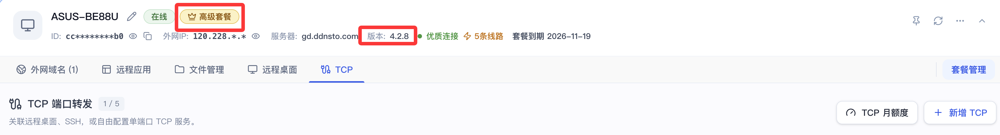

---

## 如何使用：

- 登录 DDNSTO 控制台 → 点击设备 → TCP → 「新增 TCP」

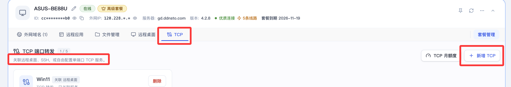

---

## 1、全新创建

- 全新创建远程桌面/远程SSH时，勾选-->同时创建TCP转发

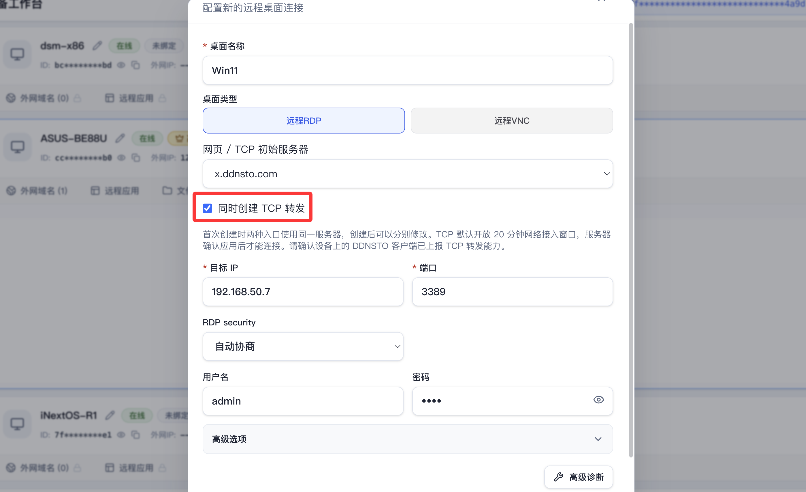

- 创建成功后查看连接教程，按照教程连接即可。

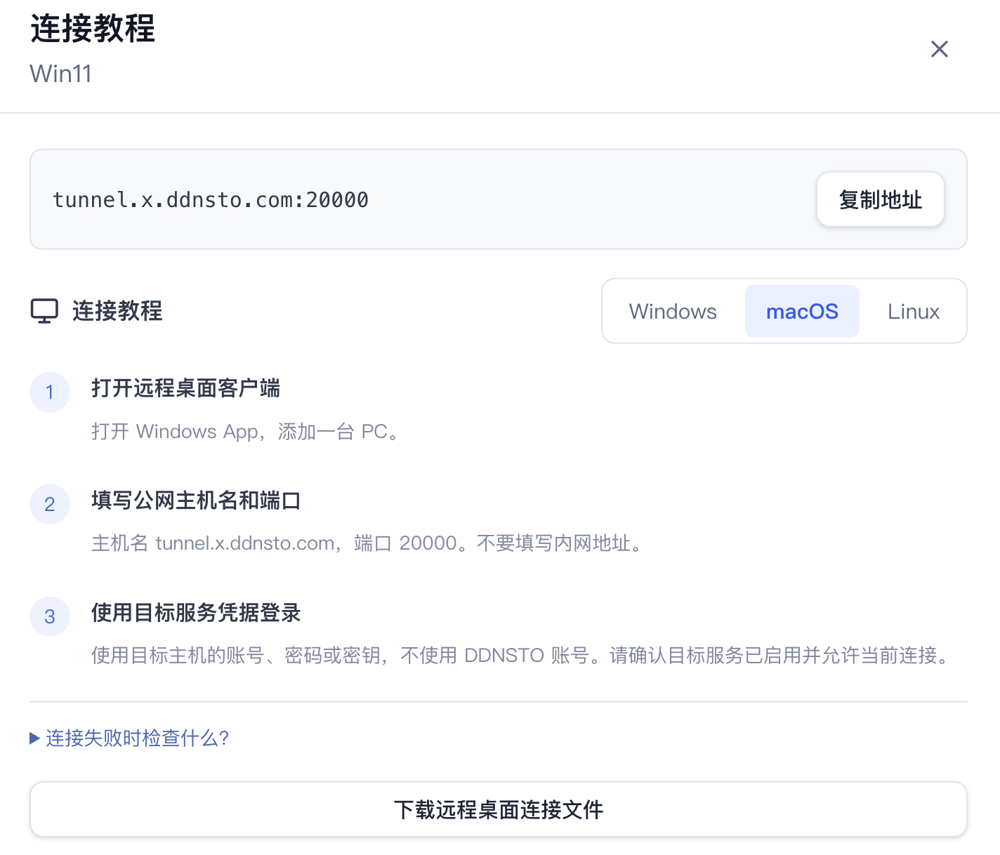

ps：远程桌面用本地客户端，体验好，方便便捷。

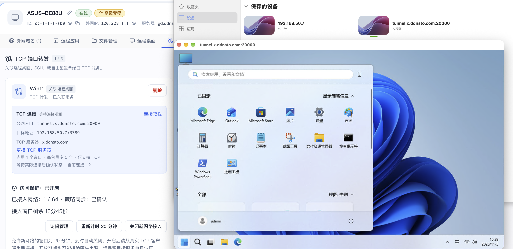

## 2、关联已有业务

- 选择已有远程SSH/远程桌面，复用名称/协议和内网目标。

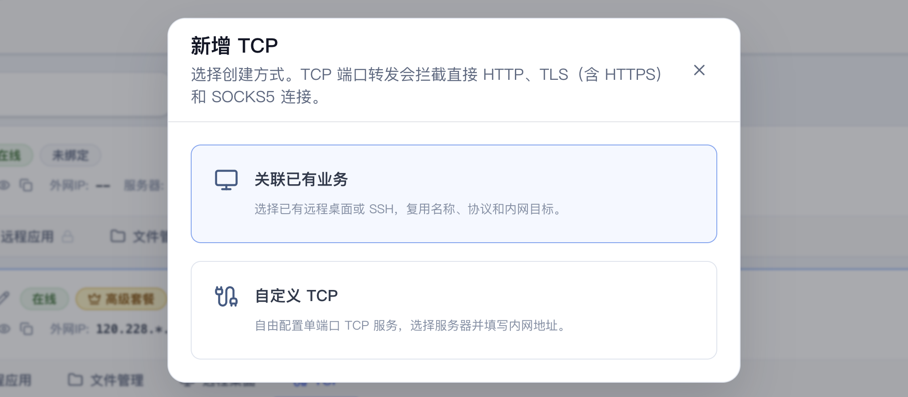

- 适合已添加了[远程SSH](./remote-desktop.html)/[远程桌面](./remote-ssh.html)且正常使用，直接关联即可。

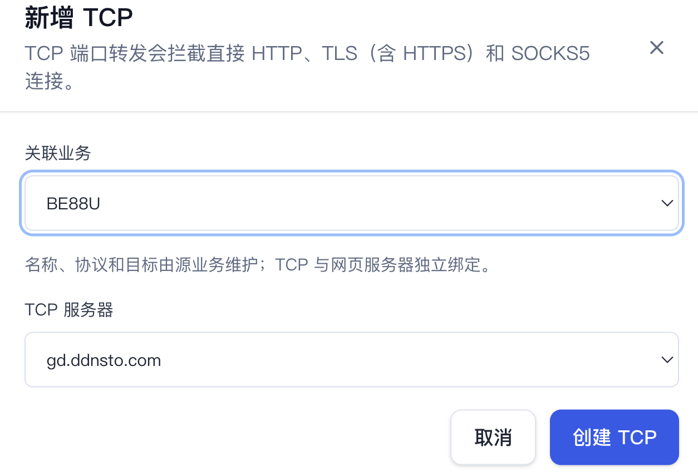

- 关联成功后查看连接教程，按照教程连接即可。

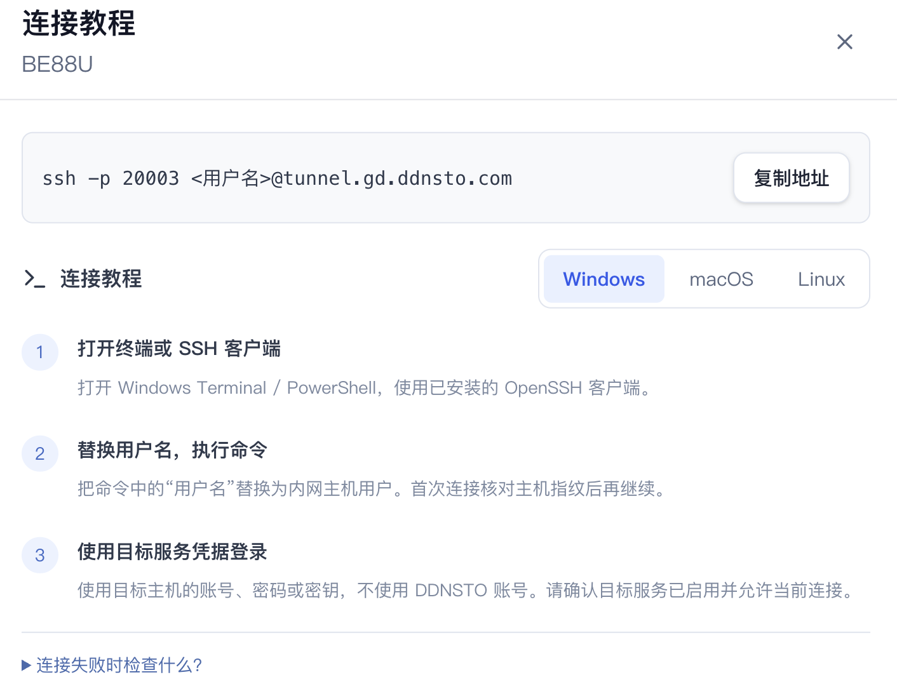

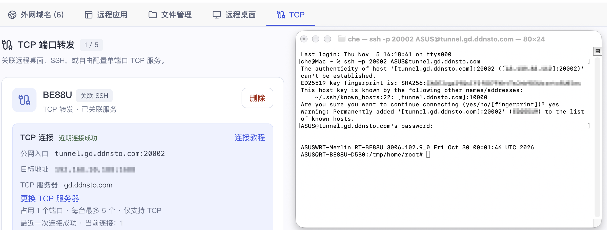

---

## 3、自定义TCP

- 自由配置单端口TCP服务，选择服务器并填写内网地址。

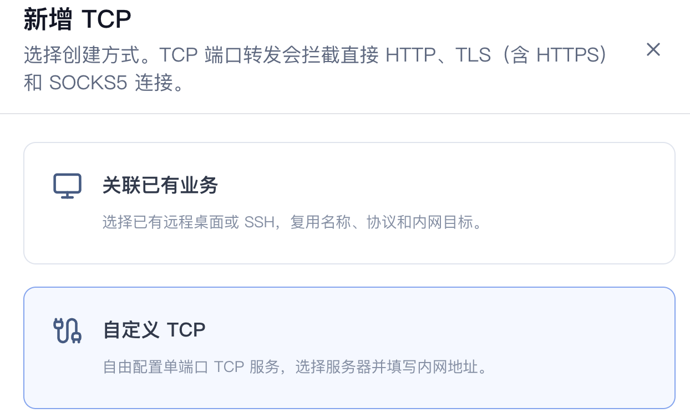

- 填写正确的协议标签、目标IP等信息后直接创建。

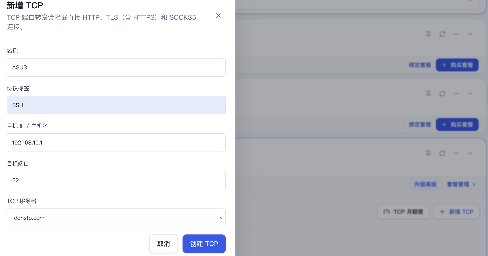

- 创建成功后查看连接教程，按照教程连接即可。
